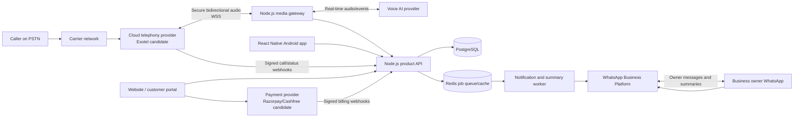
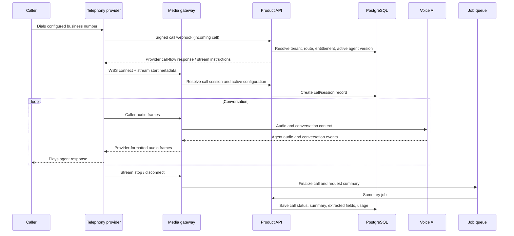
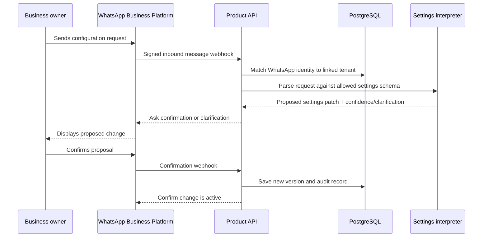

# Callivaan — System Architecture

**Status:** Draft for MVP implementation  
**Date:** 13 October 2026  
**Related document:** [Product Requirements Document](ai-call-assistant-prd.md)

## 1. Architecture goals

- Answer calls through cloud telephony and connect live audio to a voice AI agent.
- Keep the Android app and website out of the real-time call media path.
- Let each business manage its agent and receive call summaries in WhatsApp.
- Protect tenant data and all provider credentials.
- Start with a simple deployable system that can split real-time media handling from ordinary APIs as load grows.
- Support direct website checkout and signed Android APK distribution.

## 2. Key architecture decisions

1. **Cloud telephony owns the phone call.** A provider number or a supported forwarding arrangement routes calls to a provider-managed call flow. The provider connects call audio to our backend over WSS.
2. **The backend owns orchestration.** It maps each provider call to a tenant and active agent configuration, coordinates the voice AI session, stores call outcomes, and starts notifications.
3. **The client apps are control surfaces.** React Native Android and the responsive website configure accounts, agent behavior, call routing, billing, and call history. They do not carry PSTN call audio.
4. **Use provider adapters.** Exotel is the first India provider candidate because its documentation describes inbound call flows and bidirectional WebSocket voicebot streams. Keep telephony and AI integration behind interfaces so another provider can be added. Number availability and forwarding eligibility must be validated before launch.
5. **Use a product-managed WhatsApp Business number for the initial pilot.** Customers pair their WhatsApp identity to their product account. This simplifies the first integration but requires tenant-safe routing and clear account pairing. Revisit per-customer WhatsApp Business onboarding if customer branding or account ownership requires it.
6. **Deploy a modular Node.js/TypeScript backend.** Start with separate API and media-gateway processes from one codebase/container image. They have different scaling and timeout needs, even if both initially run on one managed host.
7. **Do not store audio by default.** Persist call metadata and summaries. Add recording/transcript storage only behind explicit customer settings, disclosure/consent flows, retention controls, and a separate storage policy.

## 3. System context

## 4. Runtime components

### 4.1 Website and Android app

- **Website:** responsive marketing site, signup, onboarding, billing, account settings, call history, and APK downloads. Next.js + TypeScript is a suitable implementation candidate.
- **Android app:** React Native + TypeScript. It provides account setup, agent configuration, test call, call history, usage, billing status, WhatsApp linking, and notification controls.
- Both clients authenticate to the API using short-lived access tokens and refresh tokens. Store tokens using platform-appropriate secure storage.
- Never put telephony, AI, WhatsApp, or payment secret keys in client bundles.

### 4.2 Product API

Node.js + TypeScript HTTP service (Fastify or Express). Responsibilities:

- Authentication, tenant membership, and role checks.
- Business profiles, agent configuration, call routing setup, and customer preferences.
- Call history, summaries, usage, and billing entitlements.
- WhatsApp pairing and notification preferences.
- Provider webhook validation and idempotent event intake.
- Admin/support operations with audit logging.

### 4.3 Media gateway

Node.js + TypeScript WebSocket service. Responsibilities:

- Accept secure WebSocket connections from the telephony provider.
- Authenticate the stream and map the provider call/stream ID to a tenant.
- Read provider audio frames, normalize codec/sample rate as required, and connect to the selected voice AI realtime session.
- Forward AI audio back to the provider using that provider's exact media protocol.
- Handle turn-taking, interruption, silence, max duration, disconnect, and provider-specific marks/clear events.
- Emit structured call events and usage measurements to the API/queue.
- Avoid logging raw audio or full media payloads.

The media gateway should use provider and AI interfaces, for example `TelephonyAdapter` and `VoiceAgentAdapter`. Each adapter owns codec conversion, event names, signature/authentication details, and provider error mapping.

### 4.4 Background worker

Worker process consumes durable jobs for:

- Final call summarization and structured field extraction when not completed in the realtime session.
- WhatsApp call summary and urgent alert delivery.
- Billing reconciliation, usage rollups, and retryable provider callbacks.
- Data-retention deletion and account export jobs.

Workers must use bounded retries, exponential backoff, dead-letter/error tracking, and idempotency keys. A notification failure must not change the call's final status.

### 4.5 External services

- **Telephony:** Exotel candidate for initial India pilot; requires confirmation of number supply, inbound routing, forwarding options, WebSocket features, pricing, and account eligibility.
- **Voice AI:** one provider selected for the MVP. Hide it behind an adapter so prompts and audio sessions can migrate later.
- **WhatsApp:** official WhatsApp Business Platform/Cloud API or an approved BSP. Business-initiated messages outside the allowed service window may require approved templates. Keep message consent and delivery status.
- **Payments:** Razorpay or Cashfree candidate. Use hosted/tokenized checkout where possible; never store card credentials.
- **Hosting:** managed container platform, managed PostgreSQL, managed Redis, and secret manager. Keep media services in a region with acceptable provider latency and data handling.

## 5. Main data flows

### 5.1 Inbound call and AI response

Implementation notes:

- Resolve a call to a tenant using a provider number/route mapping and validated provider call metadata. Do not trust a caller-supplied tenant ID.
- Snapshot the active agent configuration/version at call start so mid-call edits cannot unpredictably alter the conversation.
- Enforce plan limits before accepting/continuing a call. Define a graceful limit response and handoff/hangup behavior.
- Use provider call ID and stream ID as deduplication keys for webhook/session events.
- If AI service fails, play a configured fallback message and record a failed/degraded call outcome.

### 5.2 WhatsApp prompt/settings update

Rules:

- Pair identities through a short-lived single-use code issued after the user signs in to the app or website.
- Require confirmation before a message changes the live prompt or operational settings.
- Constrain the interpreter to a typed allowlist: language, tone, greeting, business facts, FAQs, fields to collect, business hours, alert rules, and follow-up instructions.
- If confidence is low, ask a follow-up question; do not guess or silently apply a change.
- Restrict sensitive actions such as changing billing, phone routing, account ownership, or data retention to authenticated app/website flows or an additional verification step.
- Store the original request, proposed patch, confirmer, timestamp, and active config version for audit.

### 5.3 Call summary notification

1. Call end event closes the active media session and records final duration/status.
2. Summary generation produces a concise text summary and structured fields; flag uncertain fields as unknown.
3. A notification job checks tenant opt-in, WhatsApp delivery eligibility, account status, and applicable message template requirements.
4. The worker sends the message and stores provider message ID/status without storing unnecessary message payloads.
5. Failed notifications retry within a bounded window; app/website call history remains the source of truth.

### 5.4 Subscription and usage

1. Website requests checkout session from the backend.
2. Payment provider collects payment and sends a signed webhook.
3. Backend validates the webhook, idempotently updates subscription entitlements, and confirms status to the client.
4. Media gateway records billable call duration and AI usage events.
5. Usage ledger aggregates minutes/cost by tenant and billing period; hard/soft limits trigger warnings or plan behavior.

## 6. Logical data model

Use UUID primary keys, timestamps in UTC, and tenant ownership on customer data. Example entities:

- `users`: login identity and account status.
- `tenants`: customer/business account, timezone, plan, and lifecycle status.
- `tenant_members`: user-to-tenant role mapping; initially owner-only, with future staff roles.
- `business_profiles`: name, category, hours, language, service area, FAQs, and escalation contact.
- `agent_configs`: versioned prompt/settings JSON, status, creator, and activation timestamp.
- `phone_routes`: tenant-to-provider number/flow mapping, provider identifiers, and setup state.
- `whatsapp_links`: tenant, WhatsApp identity, verified state, paired-at time, and opt-in preferences. Protect personal identifiers and avoid exposing them in logs.
- `calls`: provider IDs, tenant, timestamps, caller metadata, status, duration, selected config version, and end reason.
- `call_summaries`: summary text, structured lead fields, confidence/unknown markers, and deletion timestamps.
- `usage_ledger`: billable minutes, AI usage units, message events, amount/currency, and billing period.
- `subscriptions`: payment customer/subscription IDs, plan, status, renewal period, and cancellation state.
- `webhook_events`: provider, external event ID, received/processed state, and error details for deduplication.
- `audit_events`: actor, tenant, action, affected record, timestamp, and minimal safe metadata.

Audio, transcript, or exported files—if later supported—belong in a private object-storage bucket with tenant-scoped access, short-lived signed URLs, lifecycle deletion, and encryption. Do not store media in the relational database.

## 7. API boundaries

Representative API routes (exact naming can change during implementation):

| Method | Route | Purpose |
|---|---|---|
| `POST` | `/v1/auth/signup` | Create account |
| `GET/PATCH` | `/v1/tenant/profile` | Read/update business profile |
| `GET/POST` | `/v1/agent-configs` | List/create proposed agent versions |
| `POST` | `/v1/agent-configs/{id}/activate` | Activate validated configuration |
| `POST` | `/v1/telephony/setup` | Begin provider/route setup |
| `POST` | `/v1/whatsapp/pairing-code` | Issue short-lived account pairing code |
| `GET/PATCH` | `/v1/notification-preferences` | Read/update opt-ins |
| `GET` | `/v1/calls` | List call history |
| `GET/DELETE` | `/v1/calls/{id}` | Read or delete call details |
| `GET` | `/v1/usage/current` | Current-period usage and limits |
| `POST` | `/v1/billing/checkout` | Create hosted checkout session |
| `POST` | `/v1/webhooks/telephony/{provider}` | Telephony events; signed/idempotent |
| `POST` | `/v1/webhooks/whatsapp` | WhatsApp verification and message events |
| `POST` | `/v1/webhooks/billing/{provider}` | Payment/subscription events |
| `WSS` | `/v1/media/{provider}` | Provider audio stream endpoint; authenticated provider connection |

All tenant-facing routes require authentication and tenant authorization. Webhook routes use provider signature validation rather than user sessions. Return only the minimum caller/tenant data required by each client screen.

## 8. Deployment topology

### MVP topology

- `web`: website/portal container or managed web deployment.
- `api`: Node.js HTTP API container.
- `media`: Node.js WSS gateway container, publicly reachable only through TLS/WSS on approved ingress.
- `worker`: background jobs container.
- Managed PostgreSQL with automated backups and point-in-time recovery where available.
- Managed Redis for queue/cache/session coordination; do not use Redis as the durable source of truth.
- Secret manager for API credentials and signing keys.
- Centralized structured logs, metrics, traces, and error reporting with PII redaction.

Docker Compose can support local development. Production should use managed services or an orchestrator that can independently scale `media`, `api`, and `worker`. Media instances should be stateless where possible; active WebSocket sessions remain pinned to the instance that accepted them. Deployments must drain existing calls before terminating media instances.

### Network boundaries

- Public: website and API HTTPS; telephony provider WSS ingress; signed provider webhooks.
- Private: database, Redis, internal worker/API calls, and administrative endpoints.
- Outbound allowlist/egress policy where feasible for AI, WhatsApp, telephony, payments, and monitoring APIs.
- TLS for all external connections; TLS for database connections when supported by the hosting provider.

## 9. Security and privacy controls

- Tenant ID must come from an authorized server-side membership lookup, not a client-provided field.
- Verify HMAC/provider signatures and timestamp/replay limits for webhooks; use constant-time comparison where applicable.
- Encrypt secrets using a secret manager; rotate credentials and restrict production access.
- Use short-lived access tokens, refresh-token rotation, password hashing, and optional MFA for owner/admin accounts.
- Apply rate limits to login, prompt edits, pairing attempts, billing actions, and public webhooks.
- Redact phone numbers, tokens, prompts containing personal data, and media payloads from routine logs.
- Record consent/opt-in timestamps, source, categories, and opt-out events.
- Support data export/deletion and configured retention jobs; keep minimal billing/audit records only as long as required.
- Restrict admin/support access, require MFA, and log read access to sensitive call details.
- Treat caller speech as untrusted input. The voice agent must not allow caller instructions to override owner configuration, reveal secrets, or trigger unauthorized actions.
- Apply spend guards to AI sessions and telephony usage; alert on unusual call volume or cost.

## 10. Resilience and failure handling

| Failure | Expected behavior |
|---|---|
| Telephony webhook delayed/retried | Verify signature, deduplicate by provider event ID, process idempotently |
| Media gateway unavailable | Provider fallback flow should play a short unavailable message or route to configured human/voicemail path |
| Voice AI provider timeout | Play fallback message, optionally offer callback capture, close cleanly, mark call degraded |
| Audio codec/format mismatch | Reject/close with clear telemetry; alert engineering; do not loop malformed audio |
| Caller hangs up | Close AI session, persist final call state, enqueue summary if enough data exists |
| Database temporarily unavailable | Avoid claiming a call record was saved; retain minimal bounded in-memory event state and retry only where safe |
| WhatsApp send rejected | Mark delivery failed with reason class; retry only transient failures; show summary in app/website |
| Payment webhook duplicated/out of order | Idempotency key and subscription state reconciliation with provider |
| Usage limit reached | Follow plan policy: warning, graceful fallback, or route to configured human; do not silently accrue unbounded charges |

## 11. Observability and operational metrics

Use correlation IDs across call webhook, media session, AI session, summary job, and WhatsApp message. Keep provider call IDs in protected operational metadata.

Track:

- Inbound call answer success and provider webhook latency.
- Time to first AI audio and end-to-end response latency.
- WebSocket disconnects, codec errors, AI errors, and fallback rate.
- Summary generation time and WhatsApp delivery success/failure.
- Usage minutes and estimated telephony/AI cost by tenant and plan.
- Payment webhook lag, subscription state mismatches, and failed renewal recovery.
- Signup-to-test-call and number setup completion.

Proposed initial service objectives for pilot (validate with product data):

- At least 95% of valid provider-routed test calls reach a defined outcome (AI, fallback, or human route).
- 95% of successful calls show a summary in call history within 60 seconds of hangup.
- 95% of eligible WhatsApp summaries are submitted to the messaging provider within 2 minutes of hangup.
- Alert on sustained media or provider error spikes; do not treat provider delivery acceptance as proof the user's handset received the message.

## 12. Local development and environments

- Environments: local, staging, production; separate provider numbers, WhatsApp configuration, databases, and secrets.
- Local API and worker can run in Docker Compose with PostgreSQL and Redis.
- For telephony/WhatsApp webhooks in local development, use a secure temporary tunnel only with test accounts and non-production secrets.
- Provide mock telephony and mock AI adapters so frontend and business logic can be developed without making paid calls.
- Staging should include a provider test route and a test WhatsApp recipient allowlist.
- Do not use production caller recordings or customer data in development fixtures.

## 13. Open architecture decisions

1. Confirm telephony provider, number type, forwarding setup, stream codec, regional hosting, call rates, and support terms.
2. Select voice AI provider and confirm telephony-compatible audio formats, supported languages, interruption behavior, data retention, and cost model.
3. Confirm WhatsApp integration model: direct Cloud API or BSP, shared product number for pilot, template approval and per-message costs.
4. Decide whether the first MVP uses a monolithic repository with separate deployable processes or separate repositories. Recommendation: one repository, separate process entry points.
5. Choose payment provider and decide whether top-ups are prepaid credits or postpaid overage.
6. Set definitive data retention periods and caller disclosure language with legal review before enabling recordings or transcripts.

## 14. Reference documentation

- [Exotel Programmable Voice](https://developer.exotel.com/docs/voice)
- [Exotel AgentStream WebSocket protocol](https://developer.exotel.com/docs/agentstream/websocket-protocol)
- [WhatsApp Business Messaging Policy](https://business.whatsapp.com/policy/preview?lang=en_US)
- [React Native TypeScript](https://reactnative.dev/docs/typescript)

Vendor features, limits, pricing, number eligibility, and messaging requirements must be rechecked during implementation and before launch.
